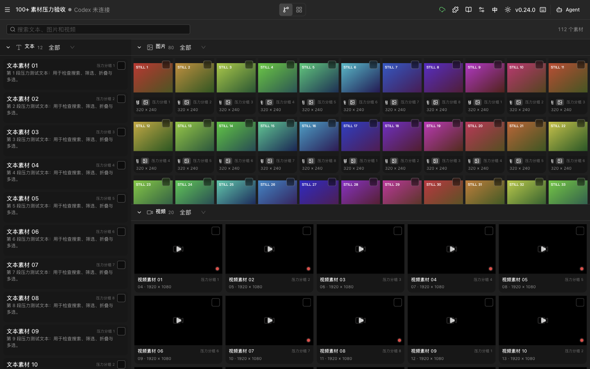
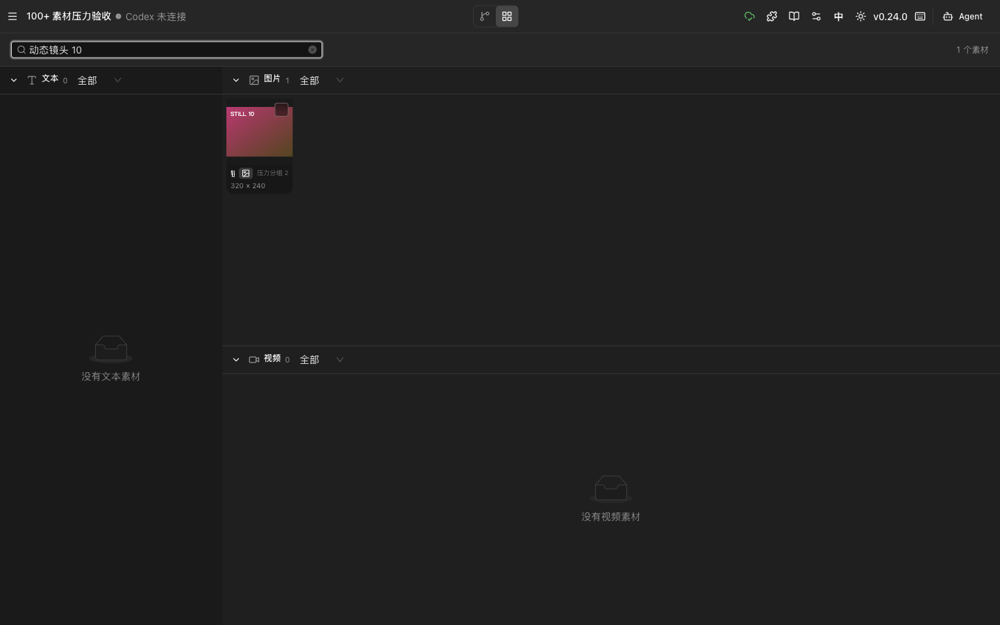
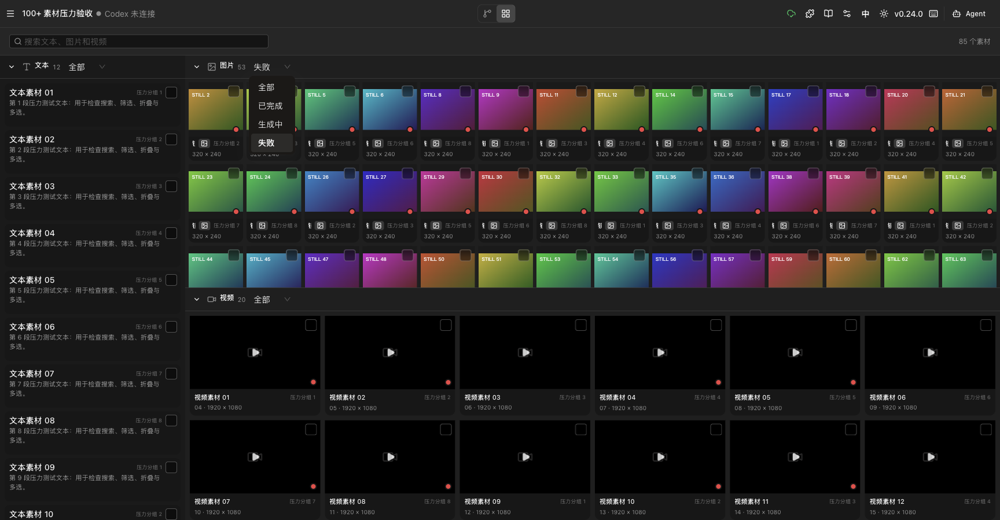
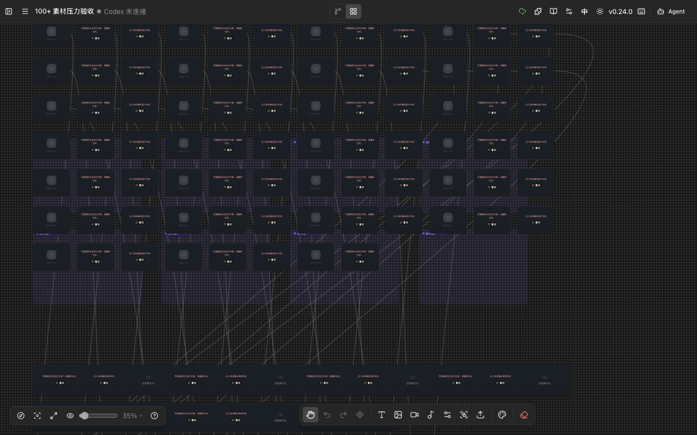
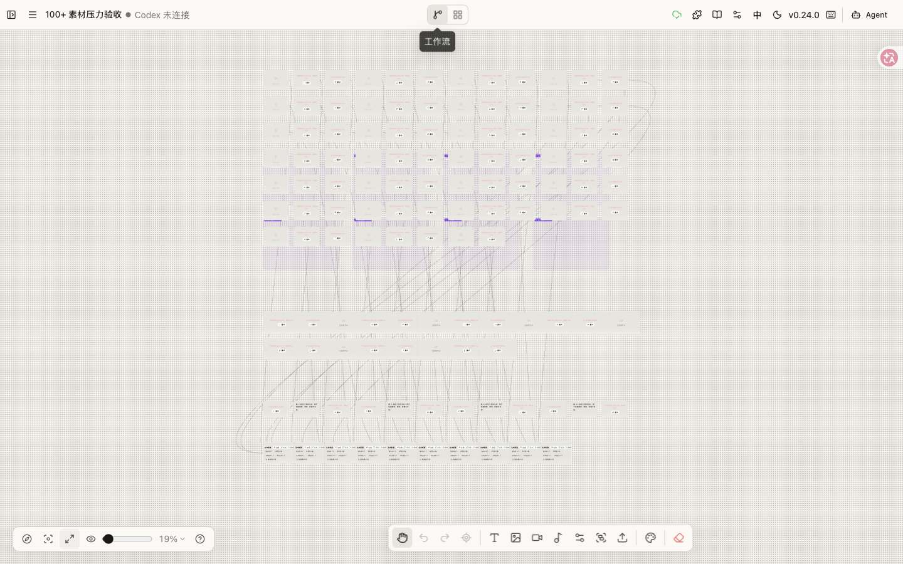
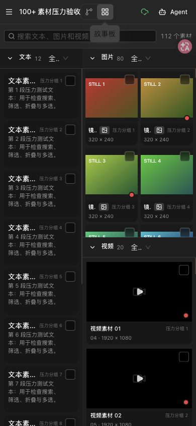
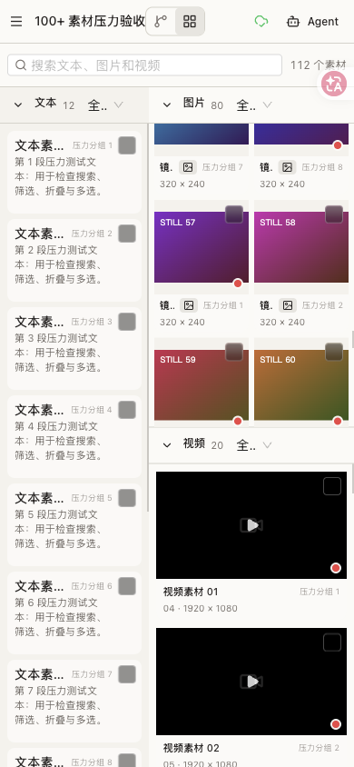

# LibTV 112 素材与触控模拟压力验收

**验收日期：** 2026-11-03

**环境：** Infinite Canvas 本地预发 `http://127.0.0.1:4185/`，Ego Browser TaskSpace `infinite-canvas-100-stress-20261103`（70）。

**结论：** 112 个素材、130 个节点和 30 条连线在 1440×900、390×844、DPR 3 和触摸事件模拟下没有出现布局溢出、卡片丢失或交互阻断。故事板滚动未观察到新增长任务；视图切换存在约 112–119ms 的单个长任务，但现有证据仍不足以证明需要引入虚拟列表。

## 测试数据

| 项目 | 数量 |
| --- | ---: |
| 图片节点 | 80 |
| 视频节点 | 20 |
| 文本节点 | 12 |
| 素材总数 | 112 |
| 分组节点 | 8 |
| 生成配置节点 | 10 |
| 节点总数 | 130 |
| 连线 | 30 |

测试项目使用独立 ID `stress112_20261103_100plus`。图片使用本地 SVG data URL，不发起模型请求；视频使用状态占位，不访问外部供应商。验收结束后从 IndexedDB 删除测试项目，不修改其他画布。

加载时，未完成的 `loading` 图片按现有恢复规则转为 `error`。因此状态筛选实测为 27 个成功图片和 53 个中断/失败图片；该行为符合生成中断恢复逻辑。

## 桌面验收

| 项目 | 结果 | 实测 |
| --- | --- | --- |
| 1440×900 工作流 | 通过 | 130 个节点，`clientWidth = scrollWidth = 1440` |
| 1440×900 故事板 | 通过 | 112 个素材，首屏图片墙 11 列 |
| 搜索 | 通过 | 搜索“动态镜头 10”后仅保留 1 个素材，清空后恢复 112 个 |
| 图片状态筛选 | 通过 | “失败”显示 53 张图片；故事板当前总数 85 |
| 模块折叠 | 通过 | 文本卡从 12 个降为 0，展开后恢复 12 个 |
| 多选返回画布 | 通过 | `text-stress-0` 和 `image-stress-1` 同时保持选中，工作流可直接继续打组 |
| 适合屏幕 | 通过 | 130 个节点完整进入视口，缩放约 19% |

### 性能采样

| 操作 | 长任务 | 结果 |
| --- | --- | --- |
| 工作流 → 故事板 | 112ms、89ms，合计 201ms | 无明显白屏或交互阻断 |
| 故事板 → 工作流 | 119ms、60ms、75ms，合计 254ms | 130 个节点完成渲染，无页面错误 |
| 图片素材区连续滚动 6×500px | 未新增长任务 | `scrollTop = 788.5` |

一次切换中存在超过 100ms 的长任务，但滚动期间没有继续出现长任务。当前不做虚拟列表；只有真实设备或更大数据量出现持续掉帧时再评估。

## 移动端与触摸模拟

| 项目 | 结果 | 实测 |
| --- | --- | --- |
| 390×844、DPR 3 | 通过 | `clientWidth = scrollWidth = 390` |
| 双栏宽度 | 通过 | 文本栏 164px，图片/视频栏 226px，合计 390px |
| 触摸切换故事板 | 通过 | 使用 CDP 触摸事件触发，页面进入故事板 |
| 触摸滚动图片区 | 通过 | 图片栏 `scrollTop` 从 0 变为 210 |
| 触摸打开图片详情 | 通过 | 显示“镜头图片 001”详情，页面横向溢出为 0 |
| 浅色主题 | 通过 | 浅色下无横向溢出，文本与素材卡保持可读 |
| 字体栈 | 通过 | 使用 `SF Pro Display`、`SF Pro Text`、`PingFang SC` 等系统字体回退 |

本项是设备模拟，不等同于真实手机验收。实体设备上的触控惯性、设备像素比、厂商字体、软键盘和长时间滚动仍需人工确认。

## 截图

| 页面 | 截图 |
| --- | --- |
| 112 素材故事板，1440×900 |  |
| 搜索单结果，1440×900 |  |
| 失败状态筛选，1440×900 |  |
| 多选返回工作流，1440×900 |  |
| 适合屏幕，1440×900 |  |
| 故事板，390×844、DPR 3 |  |
| 浅色故事板，390×844、DPR 3 |  |

## 后续边界

- 需要真实手机和真实桌面浏览器补验触控惯性、系统字体、软键盘、HiDPI 和长会话滚动。
- 可继续准备 180–200 节点样本，观察是否进入持续掉帧区间；目前不提前引入虚拟列表。
- 真实供应商、公开分享、FYT 服务端任务和生产部署仍使用各自的独立验收停止线。
