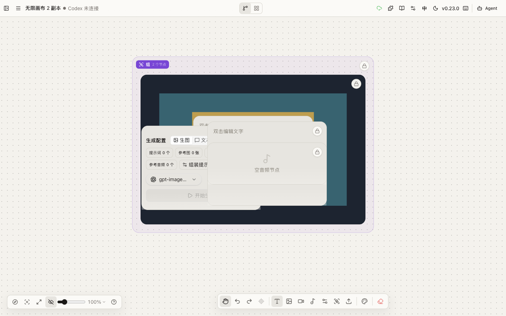
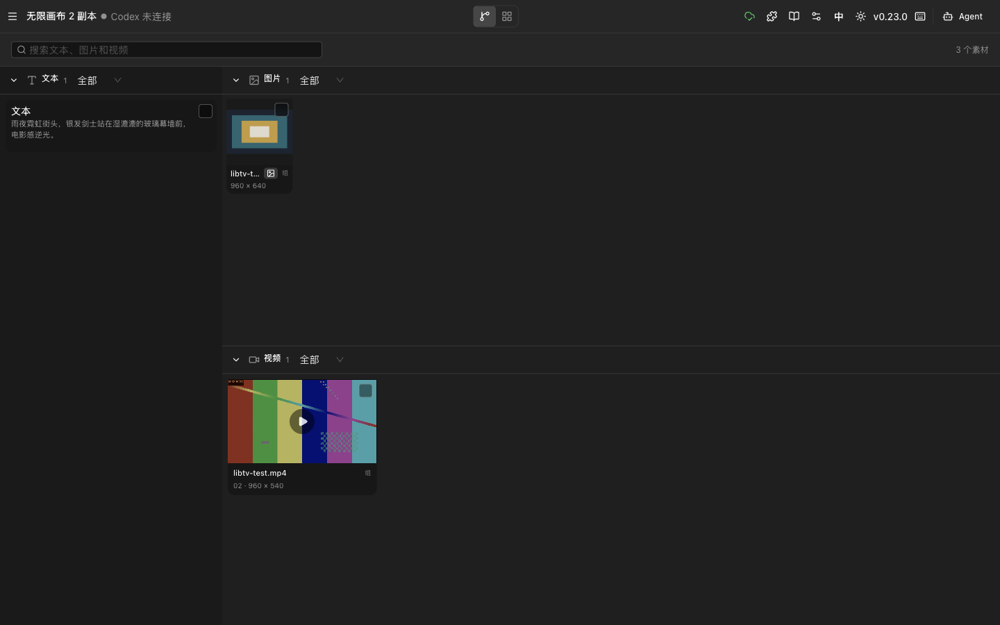
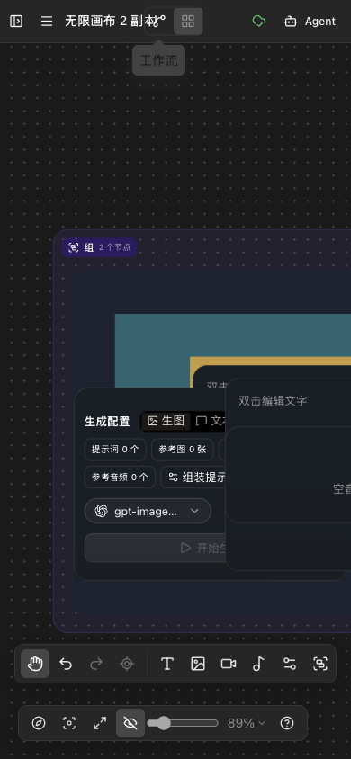
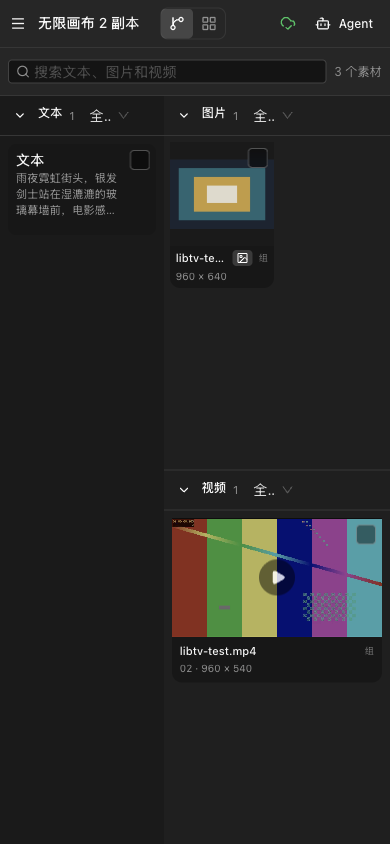

# LibTV 视觉改动浏览器验收

**验收环境：** Infinite Canvas 本地预发版本，Ego Browser，TaskSpace `infinite-canvas-libtv-visual-audit-20261103`。

**结论：** 本轮视觉改动没有发现阻断性问题。桌面与窄屏布局、深色与浅色主题、故事板搜索/筛选/折叠/多选、定位回画布以及双标签页冲突提示均通过。上一轮记录的四项“未确认失败”经复核都是测试断言问题，不是产品回归。

## 测试范围

| 项目 | 值 |
| --- | --- |
| 本地预发 | `http://127.0.0.1:4173/` |
| 测试项目 | `http://127.0.0.1:4173/canvas/AuZSbHL_Ny663bC6HXqgb` |
| 桌面视口 | 1440 × 900 |
| 移动视口 | 390 × 844 |
| 缩放 | 100% |
| 测试数据 | 9 个画布节点，故事板 3 个素材，其中文本 1、图片 1、视频 1 |
| 主题 | 深色、浅色 |

## 验收结果

| 项目 | 结果 | 证据 |
| --- | --- | --- |
| 1440px 工作流 | 通过 | `clientWidth = scrollWidth = 1440` |
| 390px 工作流 | 通过 | 无页面横向溢出 |
| 顶栏 | 通过 | 高 48px；深色 `#262626`，浅色 `rgba(251,250,247,.98)` |
| 视角切换 | 通过 | 工作流/故事板各 32×30，整体约 64×32 |
| 点阵背景 | 通过 | 100% 下 16×16px；深色 `#474747`，浅色 `rgba(68,64,60,.28)`；opacity 1 |
| 背景模式切换 | 通过 | 空白模式无网格，恢复点阵后 16px |
| 紫色分组 | 通过 | 深色 `rgba(139,92,246,.10)`；浅色 `rgba(109,40,217,.055)`；边框透明度 .22；圆角 20px |
| 故事板桌面布局 | 通过 | 左栏 320px，右侧素材区 1120px |
| 故事板移动布局 | 通过 | `clientWidth = scrollWidth = 390`；文本 164px，图片/视频 226px，无横向溢出 |
| 模块折叠 | 通过 | 收起图片模块后图片和选择按钮从 DOM 消失；展开后恢复 |
| 故事板筛选 | 通过 | 图片模块 `全部 1 → 生成中 0 → 已完成 1 → 全部 1` |
| 故事板多选 | 通过 | 图片和视频两项可同时选中，按钮显示“在画布中处理”且未禁用 |
| 多选返回画布 | 通过 | 点击后返回工作流，`image` 和 `video` 两个节点进入选中态 |
| 双标签页冲突 | 通过 | 另一标签页保存后显示“检测到其他标签页更新”，提供“保留当前页面/载入最新版本” |
| 素材详情与定位 | 通过 | 图片详情标题正确，可“定位到画布”并选中对应节点 |
| 搜索 | 通过 | 2 个结果可筛空并恢复 |

### 浅色主题

| 检查项 | 实测 |
| --- | --- |
| 主题持久化 | `infinite-canvas:theme_store` 从 `dark` 切到 `light` |
| 顶栏 | `rgba(251,250,247,.98)`，48px |
| 画布 | `rgb(244,242,237)` |
| 点阵 | 16×16px，`rgba(68,64,60,.28)`，opacity 1 |
| 节点文字 | `rgb(41,37,36)` |
| 分组面 | `rgba(109,40,217,.055)` |
| 分组边框 | `rgba(109,40,217,.22)` |

从 390px 模拟切回 1440px 时曾出现一帧左下黑色三角合成残影；稳定重绘后消失，且 DOM 命中区域没有对应元素。该现象判定为 Ego/CDP 视口切换的渲染残影，不是页面元素或样式回归。

## 自动化检查

在 `web/` 目录执行：

| 命令 | 结果 |
| --- | --- |
| `bun test` | 106 通过，0 失败，338 次断言 |
| `bun run typecheck` | 通过 |
| `bun run build` | 通过 |
| `git diff --check` | 通过 |

构建仍有既有的动态导入重复引用和超大 chunk 警告，本轮未引入新的构建错误。

根目录直接执行 `bun test` 会尝试运行 `canvas-agent`，当前缺少 `strip-ansi`、`zod`、`winston`、`gray-matter` 等依赖，因此不作为本轮前端验收结果。该问题属于工作区依赖完整性，需单独处理。

## 截图

| 页面 | 截图 |
| --- | --- |
| 深色工作流，1440×900 |  |
| 深色故事板，1440×900 |  |
| 浅色工作流，1440×900 |  |
| 移动工作流，390×844 |  |
| 移动故事板，390×844 |  |

## 后续任务

本轮不需要立即修复阻断缺陷。下一阶段应继续扩大真实数据密度和交互回归，再收敛剩余 P1/P2 视觉细节。

### P0：交付前必须补齐

| ID | 任务 | 验收标准 |
| --- | --- | --- |
| A-01 | 建立高密度故事板压测数据 | 至少准备 30 个图片、12 个视频、10 个文本节点，覆盖不同尺寸、状态、分组和空内容 |
| A-02 | 高密度桌面验收 | 1440px 下图片网格保持稳定列宽，不出现卡片重叠、文本截断失控、模块滚动错位 |
| A-03 | 高密度移动验收 | 390px 下双栏结构不破坏，左右模块可独立滚动，图片/视频详情弹窗不溢出 |
| A-04 | 完整故事板回归 | 搜索、状态筛选、模块折叠、全选、清除、多选处理、详情定位连续执行后状态仍正确 |
| A-05 | 节点功能回归 | 锁定持久化、复制项目、撤销/重做、打组/解散组、删除和跨标签保存冲突均通过 |
| A-06 | 安全验收 | 全程使用本地素材和 mock/未配置渠道，不触发真实付费模型 |

### P1：视觉继续对齐

| ID | 任务 | 验收标准 |
| --- | --- | --- |
| B-01 | 分组标题圆角从 8px 收到 6px | 深色、浅色下均保持短标签形态，不破坏 24px 标题高度 |
| B-02 | 统一连线颜色、hover 和选中态 | 默认线不抢媒体内容；hover 与选中可辨，不依赖单一颜色 |
| B-03 | 降低节点 hover 工具栏视觉重量 | 减少底色、边框和阴影，按钮仍清楚可点 |
| B-04 | 对齐小地图、详情抽屉、右键菜单 | 高度、圆角、边框和背景层级与顶栏、分组、故事板一致 |
| B-05 | 收紧视角切换动画 | 工作流/故事板切换不闪白、不跳滚动位置、不丢选中状态 |
| B-06 | 检查浅色主题对比度 | 顶栏、点阵、分组、节点文字、禁用态和 selected 态均达到可读标准 |

### P2：稳定性与工程质量

| ID | 任务 | 验收标准 |
| --- | --- | --- |
| C-01 | 补故事板投影与筛选边界测试 | 同一节点多图、空文本、失败媒体、加载中媒体、跨分组搜索均有自动化覆盖 |
| C-02 | 补多选返回画布的自动化测试 | 校验返回工作流后的 selected node ids，而不是只校验节点数量 |
| C-03 | 补双标签页冲突的组件级测试 | 至少覆盖“载入最新版本”和“保留当前页面”两个分支 |
| C-04 | 评估大素材量下的虚拟化 | 先测 50+ 素材的滚动和选择性能，只有出现明确卡顿再引入虚拟列表 |
| C-05 | 建立截图基线 | 固定 1440×900、390×844、深色、浅色四组基准图；截图前统一缩放、主题和测试数据 |
| C-06 | 处理根目录测试依赖 | 明确 `canvas-agent` 与 `web` 的测试边界，或在根目录脚本中避免误跑未安装依赖的包 |

推荐执行顺序：`A-01 → A-02 → A-03 → A-04 → A-05 → B-01/B-02/B-03 → C-01/C-02/C-03`。
