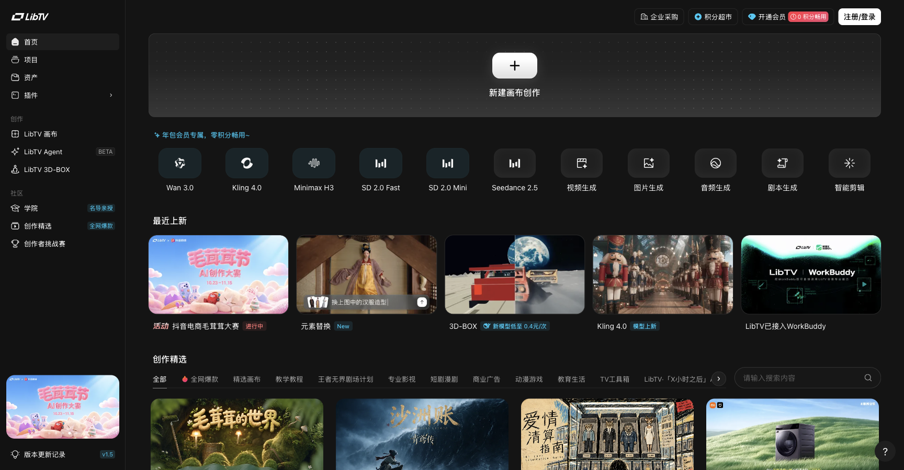
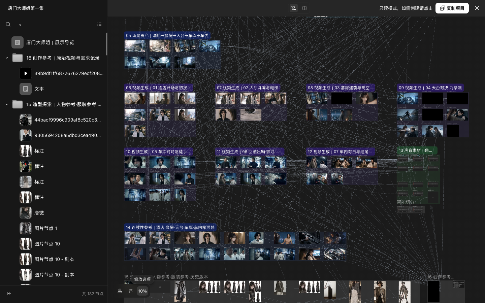
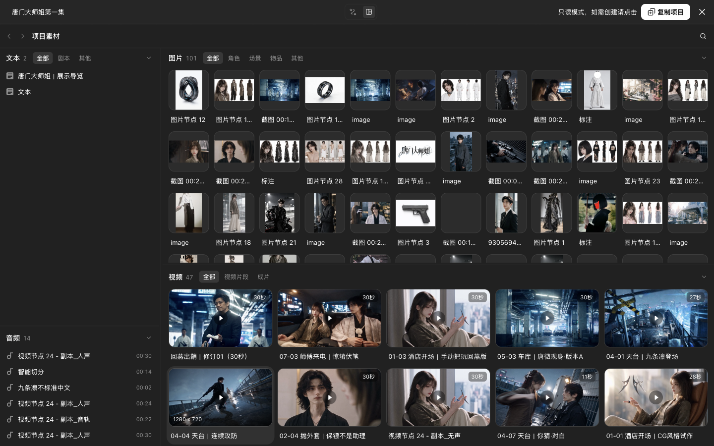
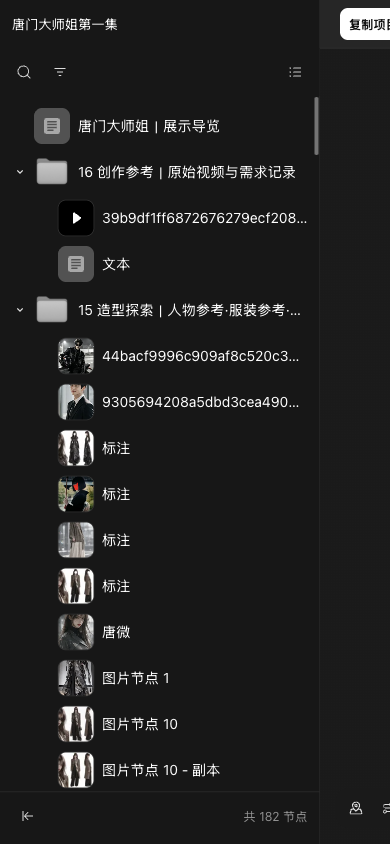
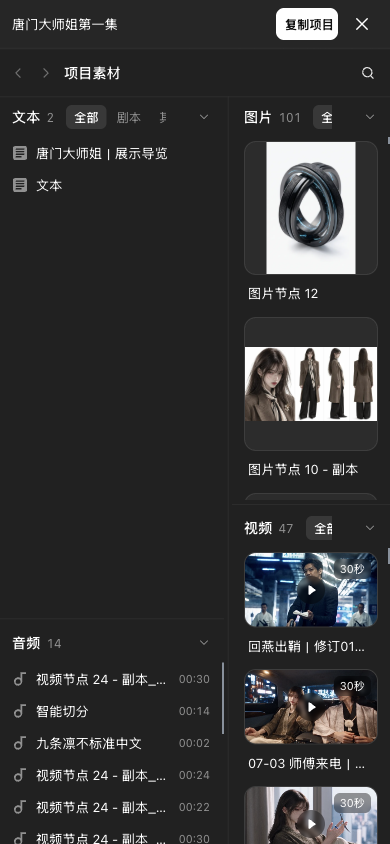
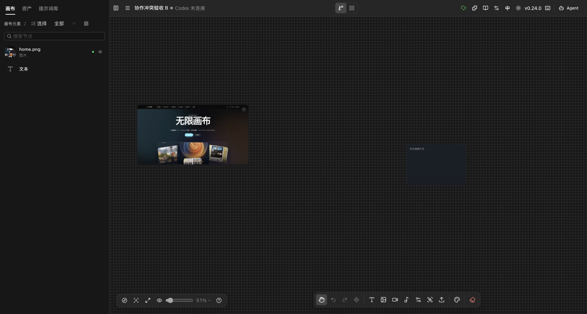

# LibTV 对齐分支合并前浏览器验收

**验收环境：** Infinite Canvas 本地预发 `http://127.0.0.1:4185/`，Ego Browser TaskSpace `infinite-canvas-libtv-migration-20261103`。

**结论：** 当前 `codex/libtv-clean-20261103` 候选分支没有发现阻断合并的前端问题。LibTV 对齐、项目自有化、节点锁定、画布复制、故事板交互、主题与窄屏布局均完成回归；本轮新增的尺寸监听和搜索选择修复通过复测。

## 交付状态

| 项目 | 结果 |
| --- | --- |
| 提交 | `1d6ec9f feat(canvas): 对齐 LibTV 工作流与故事板体验` |
| Pull Request | [#20](https://github.com/Smithhss/infinite-canvas/pull/20)，目标 `dev` |
| Quality CI | 通过，run `41585499344` |
| 合并 | 尚未合并 |
| 生产部署 | 未执行 |

## 验收范围

| 项目 | 值 |
| --- | --- |
| 本地预发 | `http://127.0.0.1:4185/` |
| 原项目 | `http://127.0.0.1:4185/canvas/VgOFkEtYsrZ089UN7h-NM` |
| 独立副本 | `http://127.0.0.1:4185/canvas/M66PCnLnmNyq2au1l289u` |
| 桌面视口 | 1440 × 900 |
| 移动视口 | 390 × 844 |
| 主题 | 深色、浅色 |
| 测试数据 | 本地图片、文本、视频节点；故事板投影；锁定节点；独立复制项目 |
| 付费渠道 | 未使用，验收过程不产生模型费用 |

## 本轮修复

| 问题 | 修复 | 结果 |
| --- | --- | --- |
| 故事板搜索隐藏已选项后，仍可能显示“已选 0 个节点”和操作按钮 | 操作区判断从 `selectedItemIds.size` 改为 `selectedNodeIds.length` | 通过 |
| 首次进入或切回工作流时，画布容器尺寸监听未重新绑定，移动端可能沿用旧尺寸 | `ResizeObserver` 只在 `workflow` 视图绑定，并在视图变化时重新测量 | 通过 |

## 交互回归

| 项目 | 结果 | 证据 |
| --- | --- | --- |
| 首页、新建画布、16px 点阵背景、48px 顶栏 | 通过 | 桌面与 390px 无横向溢出 |
| 图片、文本、视频节点导入与故事板投影 | 通过 | 媒体、标题、状态与来源 `nodeId` 正确 |
| 故事板搜索、状态筛选、模块折叠 | 通过 | 筛空后恢复；搜索隐藏已选项后操作区消失 |
| 图片/视频详情与定位回画布 | 通过 | 详情内容正确，返回后对应节点被选中 |
| 多选返回工作流 | 通过 | 节点保持选中，打组入口可用 |
| 50%、100%、适合屏幕缩放 | 通过 | 预设值与画布视口一致 |
| 连线显隐 | 通过 | 仅影响显示，不改写项目连线数据 |
| 节点锁定 | 通过 | 阻止拖动、Delete 和删除按钮；刷新与清空画布后仍保持 |
| 画布复制 | 通过 | 生成独立 URL，节点、媒体、锁定状态和视口保留 |
| 深色、浅色主题 | 通过 | 画布、点阵、分组、节点文字和工具栏可读 |
| 1440px / 390px 布局 | 通过 | `clientWidth = scrollWidth`；移动端左侧面板默认隐藏 |
| 双标签页冲突：载入最新版本 | 通过 | 页面重载并回到最新节点状态 |
| 双标签页冲突：保留当前页面 | 通过 | 弹窗关闭，当前页保持 2 个节点和原标题，不载入另一标签页新增节点 |
| 控制台冒烟 | 通过 | `errors: []` |

### 冲突保留分支实测

1. 两个标签页同时打开同一画布。
2. 第二个标签页新增文本节点并等待保存完成。
3. 当前页出现“检测到其他标签页更新”弹窗。
4. 点击“保留当前页面”。
5. 弹窗关闭，当前页仍保持原有 2 个节点和标题“协作冲突验收 B”；第二个标签页新增的第 3 个节点未被载入。

## 自动化检查

在 `web/` 目录执行：

| 命令 | 结果 |
| --- | --- |
| `bun test` | 122 通过，0 失败，585 次断言 |
| `bun run typecheck` | 通过 |
| `bun run build` | 通过 |
| `git diff --check` | 通过 |

已通过的相关子项目检查：

| 目录 | 检查 | 结果 |
| --- | --- | --- |
| `docs/` | `bun run types:check`、`bun run build` | 通过 |
| `plugins/canvas/registry/` | `npm run build`、`npm run validate` | 通过，5 个插件 |
| 仓库根目录 | `docker compose config` | 通过 |

PR Quality CI 还覆盖了 standalone Web、FYT-managed Web、Docs 类型检查和 whitespace。仓库的 Docker 镜像与插件发布工作流只在版本 tag 或手动触发时发布远端制品，不属于 PR 检查。

已知既存警告，不是本轮新增错误：

- Web 主 chunk 约 3.99 MB。
- `image-storage.ts`、`use-canvas-store.ts` 存在动态与静态重复导入警告。
- Docs `next.config.mjs` 仍有 Turbopack NFT 警告。
- 本地应用与 Docs Docker 镜像构建未完成：Docker Hub 的 `auth.docker.io` token 请求持续返回 TLS EOF。插件本地构建与校验已通过，镜像构建仍待仓库 tag 工作流或网络恢复后复核。

敏感信息扫描未发现真实密钥。

## 截图

| 页面 | 截图 |
| --- | --- |
| 首页 |  |
| 深色工作流 |  |
| 深色故事板 |  |
| 移动工作流 |  |
| 移动故事板 |  |
| 冲突提示保留当前页面 |  |

## 剩余边界

- Phase 5C 公开只读分享仍需要服务端项目存储、权限、分享凭证和审计契约，当前分支不提供伪分享。
- 112 个素材的桌面、DPR 3 和触摸事件模拟已通过，详见 [112 素材压力验收](2026-11-03-libtv-112-stress-acceptance.md)；真实手机触控惯性、软键盘、系统字体和长时间滚动仍需实体设备验收。
- 浏览器存储命名空间迁移仍暂缓，避免未备份时丢失现有画布和资产。
- 已提交、推送并创建 PR；尚未合并 `dev`、发布镜像或部署生产。
