# LibTV 视觉差异审计

**审计日期：** 2026-11-03

**范围：** LibTV 公开只读项目的“工作流 / 故事板”视觉基准，对照 Infinite Canvas 本地预发版本。本文记录基准、差距、实施计划和同轮落地结果。

**关联计划：** [Infinite Canvas LibTV 对标执行计划](../plans/2026-11-02-infinite-canvas-libtv-execution-plan.md)

**浏览器验收：** [LibTV 视觉改动浏览器验收](2026-11-03-libtv-browser-acceptance.md)

## 结论

当前版本已经具备工作流、故事板、三类素材模块、搜索筛选、定位回画布、批量选择和缩放控制，功能骨架基本对齐。主要差距不在功能数量，而在视觉系统：

- LibTV 的核心观感是“高密度、媒体优先、低 chrome、深灰层级 + 紫色语义分组”。
- 当前画布仍偏向“独立卡片工作台”：默认没有点阵，点阵过疏且整体透明度过低，顶栏和浮动控件视觉重量偏高。
- 工作流节点和分组仍以大边框卡片为主，没有形成 LibTV 那种“内容本身即节点”的轻量画面。
- 故事板在大屏上留白过多，首屏素材数量和信息密度明显低于 LibTV；390px 下又退化为单列大模块。

建议按 P0 -> P1 -> P2 分四段实施，先统一背景、顶栏、节点分组和故事板密度，再处理项目导航、工具控件和移动端，最后微调连线、选中态、hover、小地图和文案。不要在现有未提交改动上一次性做整页重写。

## 实施进展

本轮已经完成 P0 和主要 P1 调整，并用真实浏览器复测：

| 项目 | 状态 | 实测结果 |
| --- | --- | --- |
| 默认点阵背景 | 已完成 | 新项目默认 `dots`；100% 下 16px 间距，点色 `#474747`，点阵层不再整体降低透明度 |
| 顶栏 | 已完成 | 完整 48px `#262626` 色带；工作流/故事板切换约 64×32；右侧控制降低高度和阴影 |
| 工作流节点与分组 | 已完成 | 图片/视频默认态取消厚边框和重阴影；分组使用紫色面、20px 圆角和 24px 深紫标题标签 |
| 故事板密度 | 已完成 | 1440px 下图片卡约 95×137，视频卡约 214×166；图片使用 88px 最小自动列 |
| 移动故事板 | 已完成 | 390px 下保持 164px 左模块 + 226px 右素材流，无横向溢出 |
| 左侧元素列表 | 已完成 | 列表行高约 44–48px，重复类型副标题不再显示 |
| 底部工具 | 已完成 | 主工具条约 44px，缩放控件约 40px，保留原有全部能力 |

最终对照截图：

| 桌面工作流 | 桌面故事板 |
| --- | --- |
| 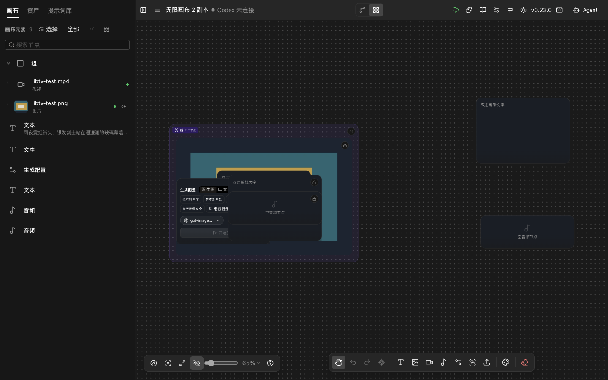 | 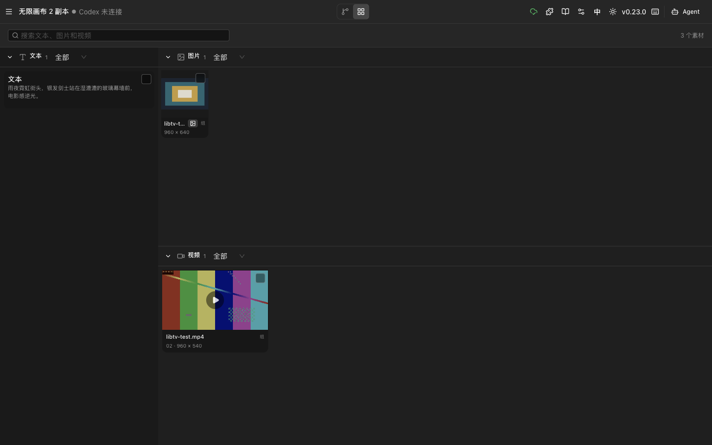 |

| 移动工作流 | 移动故事板 |
| --- | --- |
| 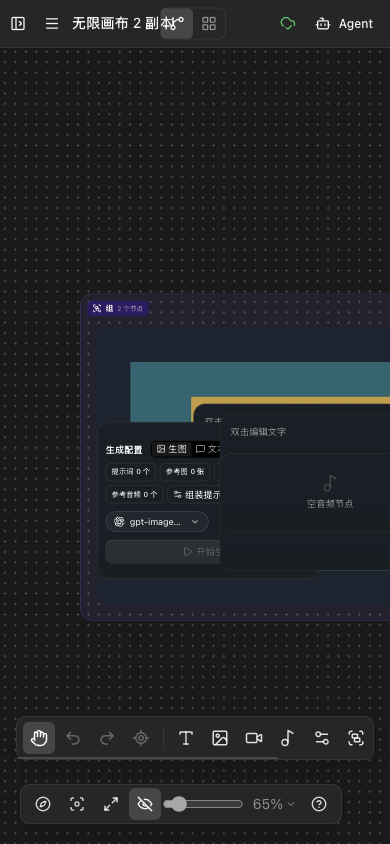 | 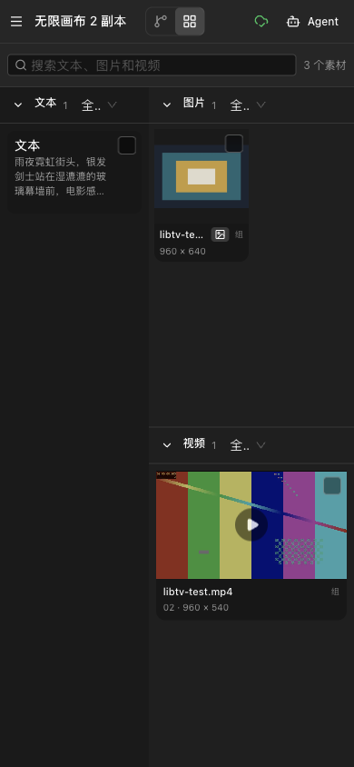 |

浏览器冒烟结果：

- 故事板搜索可以筛空并恢复，工作流/故事板往返正常。
- 1440×900 和 390×844 均无页面横向溢出。
- 390px 工作流在收起左栏后，主工具条宽 358px、高 44px，缩放控件高 40px。
- 自动化测试、类型检查和构建结果记录在本轮交付说明中；仍未验证 LibTV 登录后的编辑态。

## 基准与证据

### LibTV 访问路径

公开只读入口：

1. 打开 LibTV 首页。
2. 进入公开作品“唐门大师姐第一集”。
3. 点击“查看制作过程”。
4. 页面进入只读工作流，地址为 `https://www.liblib.tv/creation/process?id=3eeb90c8312745aeae974397e6235a0a`。

页面明确显示“只读模式，如需创建请点击 复制项目”。因此本次确认范围仅包括公开作品的工作流、故事板、桌面和窄屏只读布局；登录后的编辑态不在已确认范围内。

### 截图证据

| 基准 | 截图 |
| --- | --- |
| LibTV 首页 | 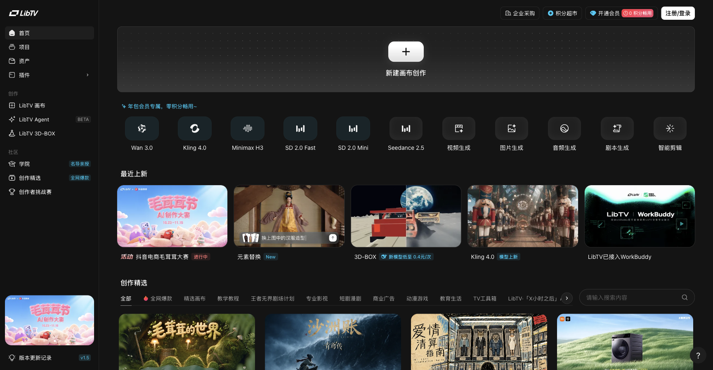 |
| LibTV 工作流，适合屏幕，1440×900 | 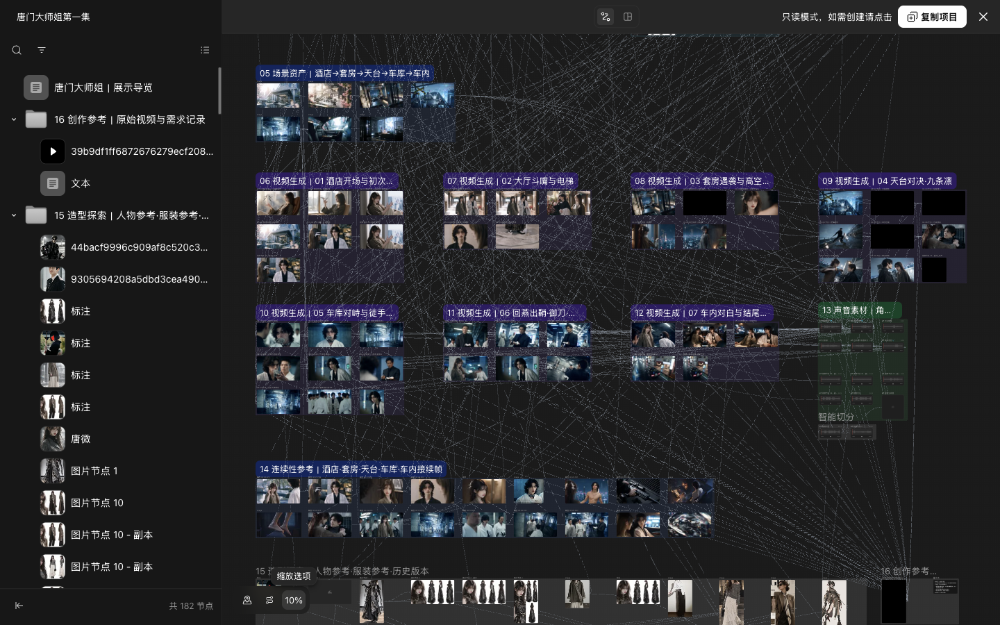 |
| LibTV 工作流，100%，1440×900 | 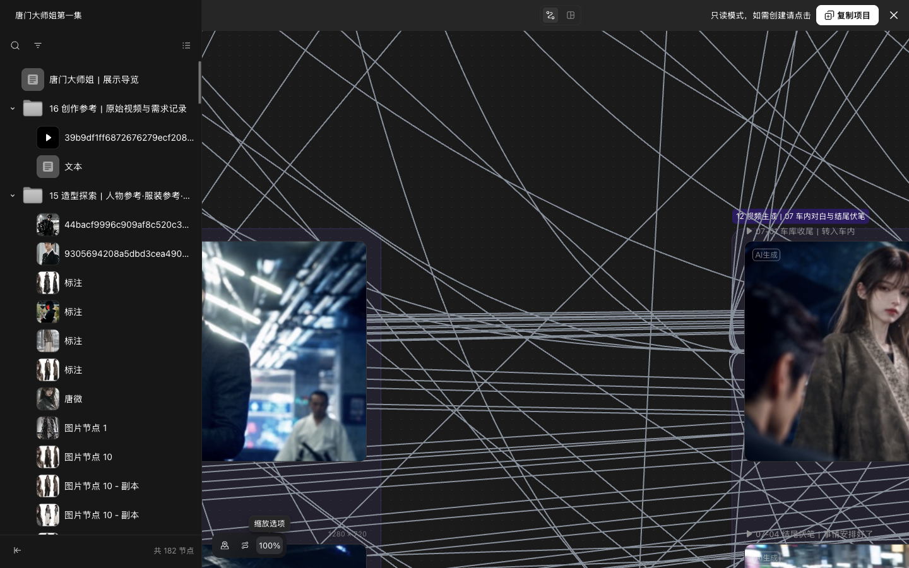 |
| LibTV 故事板，1440×900 | 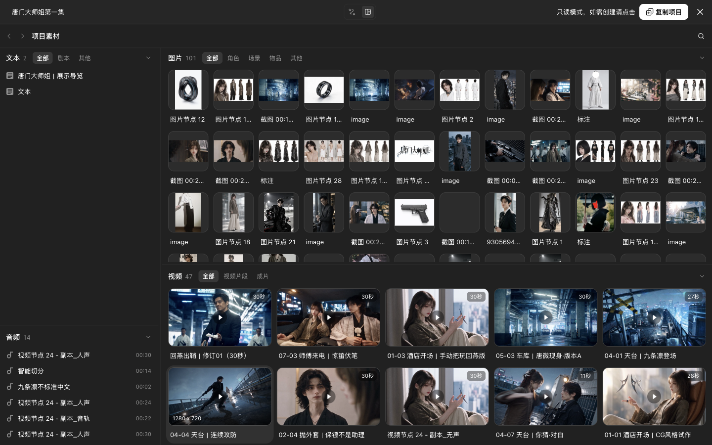 |
| LibTV 工作流，390×844 | 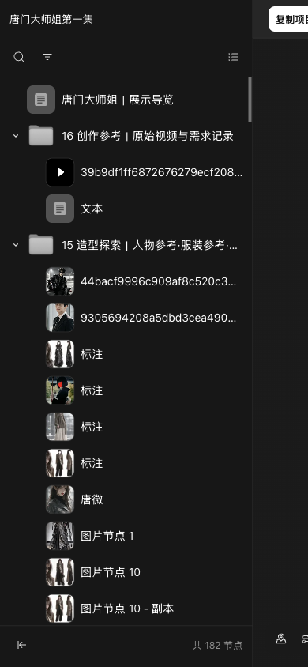 |
| LibTV 故事板，390×844 | 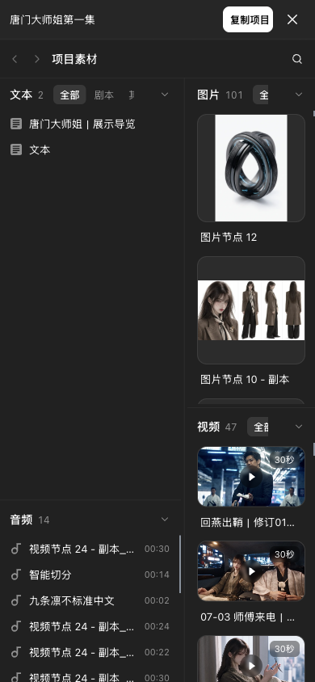 |
| Infinite Canvas 工作流，深色 | 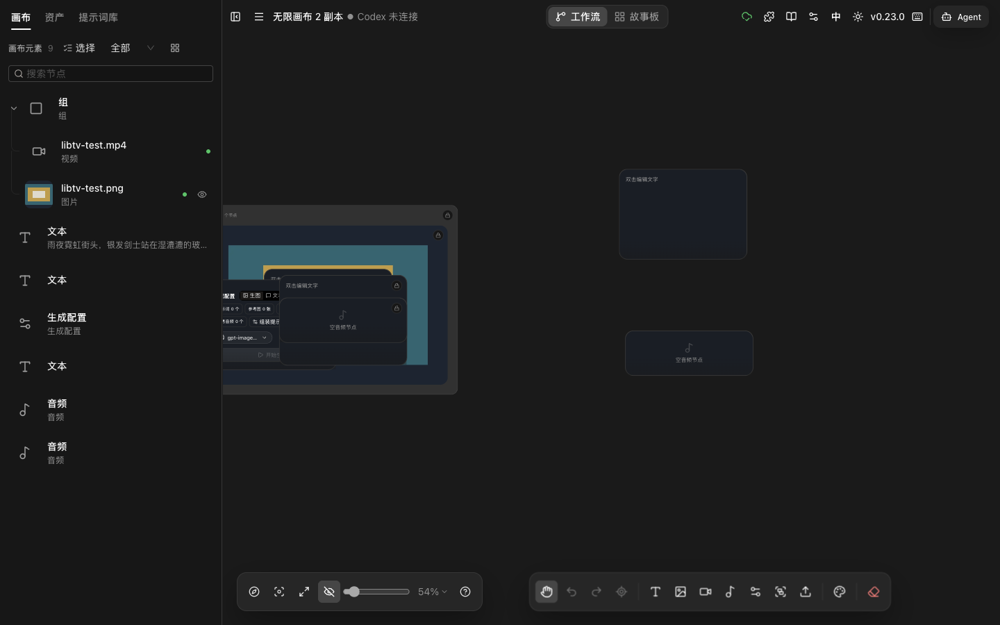 |
| Infinite Canvas 工作流复测 | 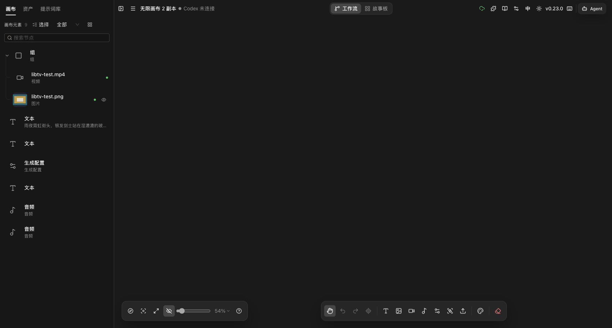 |
| Infinite Canvas 点阵，100% | 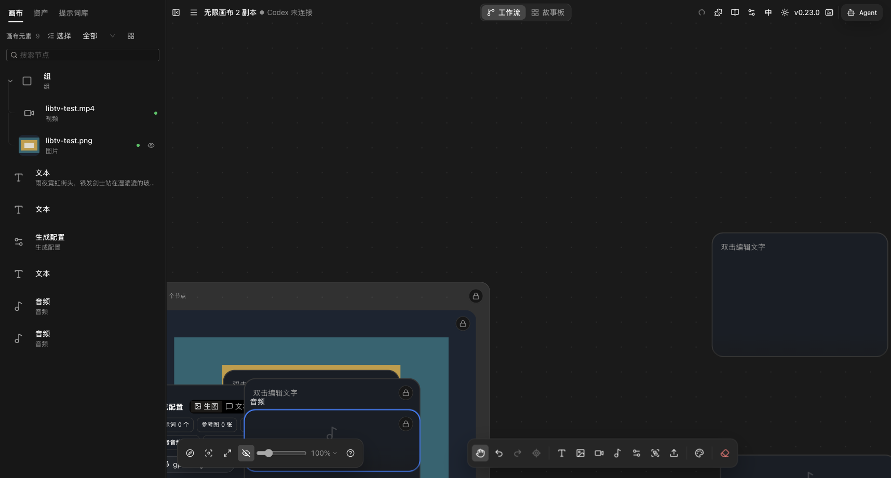 |
| Infinite Canvas 故事板，1440×900 | 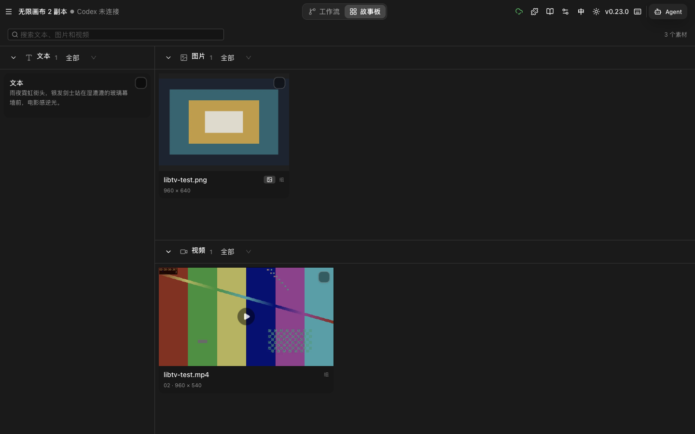 |
| Infinite Canvas 故事板，390×844 | 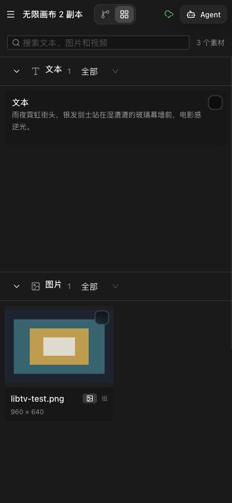 |

### 本地对照环境

- 本地预发首页：`http://127.0.0.1:4173/`
- 测试项目：`http://127.0.0.1:4173/canvas/AuZSbHL_Ny663bC6HXqgb`
- 浏览器：Ego Browser，独立 TaskSpace `infinite-canvas-libtv-visual-audit-20261103`
- 桌面基准：1440×900
- 移动基准：390×844

截图来自真实浏览器，但颜色值可能受显示器色彩配置、截图缩放和页面叠层影响，实施时以浏览器计算样式和实际渲染为准，不以单张截图的取色作为唯一依据。

## 视觉基准

### 关键尺寸与颜色

| 元素 | LibTV 实测 | Infinite Canvas 当前实测 |
| --- | --- | --- |
| 页面背景 | `#141414` | 深色主题近黑灰 |
| 画布背景 | `#1a1a1a` | `#1a1a1a` |
| 左侧项目栏 | 约 320px，`#171717` | 已有独立侧栏，行高和密度不同 |
| 顶栏 | 约 48px，完整色带 `#262626` | 透明浮层，没有完整高度色带 |
| 点阵 | `#474747`，约 16×16px，100% 清晰可见 | 48px 间距，容器整体 `opacity: .4` |
| 分组底色 | 紫色 `rgba(139, 92, 246, .1)` | 深色主题白色 10% 透明度 |
| 分组边框 | 紫色，约 20% 透明度 | 通用中性色边框 |
| 分组圆角 | 约 20px | 与具体节点尺寸和分组实现相关 |
| 分组标题 | 高 24px、圆角 6px、12px 白字，深紫底 | 通用节点标题样式 |
| 连线 | `#86909c`，约 2px，无明显箭头 | 沿用现有连线样式 |
| 工作流/故事板切换 | 约 65×32px，圆角 8px，0.5px 边框 | 约 176×34px |
| 缩放控件 | 约 110×40px，`rgba(16, 16, 16, .7)`，圆角 12px，无边框 | 浮动 dock 更大，层级更明显 |
| 故事板主面板 | 约 `#212121` | 深色面板 |
| 故事板左栏 | 约 320px，`#1a1a1a` | 已有左栏，但素材分组纵向占用更大 |
| 故事板图片卡 | 1440px 下约 89.6×121.6px，圆角 16px | 大卡片，首屏横向数量明显更少 |
| 故事板视频卡 | 约 227×163.2px | 大卡片，首屏信息密度更低 |

### 核心视觉语言

1. **背景有纹理但不抢内容。** 16px 点阵在 100% 缩放下可见，形成空间尺度感；它更像画布纸面，而不是装饰图层。
2. **控件小而分散。** 左右两侧工具和顶部状态降低视觉重量，中央视角切换仍是明确操作，但不占大块空间。
3. **媒体内容优先。** 工作流分组主要通过紫色面、短标题和媒体缩略图表达，不依赖厚重卡片外框。
4. **故事板是素材墙。** 图片以小卡密排，视频以横向比例卡展开，文本和音频作为辅助模块；用户首先看到内容，而不是面板结构。
5. **移动端保留信息架构。** 390px 下仍是“左导航 + 右素材流”的双栏结构，卡片变窄但不把单个文本模块拉满整屏。

## P0

### P0-1 画布背景改为 LibTV 风格深色点阵

**当前状态**

- 新项目默认背景模式是 `blank`。
- 点阵使用 48px 间距。
- 点阵所在的整体容器设置了约 `0.4` 透明度，导致 100% 缩放下对比度不足。

**目标**

- 新项目默认启用点阵背景，至少深色主题默认启用。
- 画布底色保持 `#1a1a1a` 附近。
- 点阵间距调整为约 16px。
- 点颜色调整到 `#474747` 附近，不再对整个点阵层统一乘 `0.4`。
- 保留浅色主题映射，不把深色值硬编码到业务组件；通过 `canvasThemes` 定义每个主题自己的底色、点色和透明度。
- 缩放时点阵应随画布移动和缩放，避免缩放后变成固定网页纹理。

**涉及位置**

- `web/src/lib/canvas-theme.ts:41`
- `web/src/stores/canvas/use-canvas-store.ts:101`
- `web/src/components/canvas/infinite-canvas.tsx:235`

**验收**

- 1440×900 下 100% 缩放可直接看见点阵，但不会压过节点内容。
- 背景模式切换、缩放、平移后点阵位置和密度正确。
- 深色与浅色主题都使用主题 token，不出现单页硬编码颜色。

### P0-2 增加 48px 顶栏色带并降低控制重量

**当前状态**

- 顶栏为透明浮层，按钮分散在画布上方。
- 工作流/故事板切换约 176×34px，视觉重量和占宽明显高于 LibTV。
- 保存、插件、文档、配置、语言、主题、版本和 Agent 入口形成一长排高权重控制。

**目标**

- 增加约 48px 的完整顶栏背景，深色主题使用 `#262626` 附近色值，与画布 `#1a1a1a` 拉开一级层次。
- 中央“工作流 / 故事板”切换压缩到约 64-96px 宽、32px 高，边框和底色收敛。
- 左侧保留项目名称和必要状态；右侧低频入口分组或折叠，不与核心视角切换竞争。
- 顶栏不用阴影，不使用大圆角胶囊；用轻边框、透明 hover 和间距建立层级。
- 窄屏优先保留视角切换、Agent 和必要状态，其余入口进入菜单。

**涉及位置**

- `web/src/components/canvas/canvas-top-bar.tsx:132`
- `web/src/components/canvas/canvas-top-bar.tsx:205`

**验收**

- 1440px 下顶栏高度稳定约 48px，项目名、视角切换和右侧操作分区清楚。
- 视角切换的视觉占宽不高于当前实现的三分之二。
- 390px 下不横向溢出，核心按钮可达，低频按钮不挤占画布。

### P0-3 工作流节点改为媒体优先，分组改用紫色语义层

**当前状态**

- 节点包含较明显的外框、标题栏和卡片底座。
- 分组在深色主题中使用中性白色透明层，和 LibTV 的紫色内容分组语义不同。
- 图片、视频和文本节点的视觉重量接近，媒体内容没有成为第一视觉层。

**目标**

- 图片和视频节点弱化外框、底色和标题栏，让媒体本体占据主要视觉面积。
- 保留选中、锁定、错误和生成中的状态边框，但默认态尽量轻。
- 分组使用深色主题下的紫色面 `rgba(139, 92, 246, .1)`，边框约 20% 透明度，圆角接近 20px。
- 分组标题改为 24px 高、12px 白字、圆角 6px 的深紫短标签，标题不横向撑满内容。
- 不复制 LibTV 图标、字体和素材，只借用层级、密度和色彩语义。
- 选中态不能只靠颜色表达，仍需保留清晰焦点环或边框，满足键盘和低色彩辨识场景。

**涉及位置**

- `web/src/components/canvas/canvas-node.tsx:370`
- `web/src/lib/canvas-theme.ts:41`

**验收**

- 工作流中出现 10 个以上媒体节点时，画面主体首先被理解为素材，而不是一组表单卡片。
- 分组边界、标题和所属节点关系一眼可辨。
- 锁定、选中、禁用、hover 和连接点状态仍清楚，不因降噪而消失。

### P0-4 故事板改为紧凑素材墙

**当前状态**

- 桌面端卡片大、模块外框和留白多，首屏能看到的素材数量远低于 LibTV。
- 文本模块在 390px 下占据接近整屏高度，图片和视频被推到下方。
- 图片卡片使用大尺寸横向容器，未形成统一、稳定的素材节奏。

**目标**

- 桌面端保留约 320px 左侧素材导航，右侧使用响应式密集网格。
- 图片卡以窄竖卡或方形媒体容器为主，1440px 下目标每行 5-7 个；视频卡保持 16:9 或接近比例，每行 2-4 个。
- 卡片阴影、外框和底色降低，缩略图成为视觉主体；标题、时长、尺寸和分组标签改为小字号弱化信息。
- 文本和音频使用紧凑模块，不占满整行高度。
- 移动端保留左侧导航与右侧素材流的双栏关系；右栏采用 2 列窄卡或高密度单列，不让一个文本模块吞掉首屏。
- 不以固定像素写死全布局，优先使用 `grid-template-columns: repeat(auto-fill, minmax(...))` 或现有 Tailwind 响应式断点。

**涉及位置**

- `web/src/components/canvas/canvas-storyboard.tsx`
- `web/src/lib/canvas/storyboard-projection.ts`

**验收**

- 1440×900 首屏图片区至少可看到 5 列，视频区至少能同时看到 2 行。
- 390×844 首屏同时出现可浏览的导航、图片或视频素材，不出现单个文本模块独占整屏。
- 搜索、筛选、折叠、多选、详情和定位回画布能力不回归。
- 页面无横向溢出，图片不被非等比拉伸。

## P1

### P1-1 压缩左侧项目列表行高

LibTV 左栏在 900px 高度内可浏览约 15 个项目，当前列表的缩略图、副标题和行间距占用更多纵向空间。

建议：

- 普通项目行以 40-48px 为主，选中项再增加细节。
- 非图片项目直接使用图标，不给缩略图铺灰色底座。
- 只保留项目名和必要类型信息，弱化重复副标题。

### P1-2 降低故事板卡片和模块间隔

建议：

- 图片媒体容器统一为可比对的方形或竖形区域。
- 卡片默认无阴影，背景只比主面板亮一级。
- 模块标题栏和分组 header 压缩高度。
- 料数、搜索和筛选放到一行或可折叠区域，避免纵向叠三层。

### P1-3 简化顶部状态和低频工具

建议：

- 保存状态用短文本或状态点表达，不占独立高权重按钮。
- 插件、文档、配置、语言、主题、版本集中到“更多”菜单。
- 保留 Agent 的明确入口，但避免用强底色与视角切换竞争。

### P1-4 收敛底部 dock 和缩放控件

建议：

- 功能入口继续保留，但减少边框、阴影和整块底色。
- 缩放控制做成独立轻量浮层，接近 LibTV 的约 110×40px 视觉体量。
- 工作流与故事板使用一致的工具视觉语言，避免一个页面是扁平按钮、另一个页面是厚重 dock。

### P1-5 重排 390px 故事板

建议：

- 左侧素材导航可横向折叠或保持窄栏。
- 右侧图片使用 2 列窄卡，视频使用 1-2 列，文本和音频压缩为短模块。
- 首要验收目标是“快速浏览素材”，不是“完整展示每个模块的所有字段”。

## P2

### P2-1 连线视觉

- 对照 LibTV 的 `#86909c`、约 2px、低箭头表达，统一默认连线、hover、选中和禁用状态。
- 连线密集时必须避免盖住媒体内容，必要时动态降低非相关连线对比度。

### P2-2 选中与 hover 状态

- 默认态进一步降噪。
- hover 只增加轻背景或轮廓，不新增整块卡片阴影。
- 选中态明确但不过度发光。

### P2-3 节点悬停工具栏

- 减少深色整块背景和阴影。
- 高频操作保留，低频操作进入菜单。
- 移动端改为点击节点后的固定操作区，避免 hover 依赖。

### P2-4 小地图和详情抽屉

- 小地图边框、底色、遮罩和视口矩形统一到新的主题 token。
- 详情抽屉减少大标题和大面积空白，优先展示媒体、尺寸、来源和关系。

### P2-5 微文案与空状态

- 统一“素材 / 节点 / 模块 / 分组”的术语。
- 计数弱化显示，例如“图片 101”，不把数字做成第二个标题。
- 空状态只保留一句操作提示和一个主要入口。

## 修改建议

按以下顺序执行，每一阶段单独验证并截图，不一次性改完整页：

| 顺序 | 批次 | 主要内容 | 主要文件 |
| --- | --- | --- | --- |
| 1 | P0-A 背景基础 | 默认点阵、16px 间距、主题 token、移除整体透明度 | `canvas-theme.ts`、`use-canvas-store.ts`、`infinite-canvas.tsx` |
| 2 | P0-B 顶栏 | 48px 色带、压缩视角切换、低频入口分组 | `canvas-top-bar.tsx` |
| 3 | P0-C 工作流节点 | 媒体优先节点、紫色分组、轻量标题和边框 | `canvas-node.tsx`、`canvas-theme.ts` |
| 4 | P0-D 故事板 | 左侧 320px 导航、密集图片网格、紧凑视频和文本模块 | `canvas-storyboard.tsx` |
| 5 | P1 精修 | 项目列表、卡片间距、顶部低频工具、底部 dock、390px 布局 | 画布组件与主题文件 |
| 6 | P2 微调 | 连线、选中、hover、工具栏、小地图、详情和文案 | 相关画布组件 |

实施约束：

- 先做深色主题的视觉基准，但颜色全部通过 `canvasThemes` 表达；浅色主题同步提供同等级层次，不照搬深色值。
- 不新增依赖，不迁移为 React Flow，不建立第二份故事板数据。
- 不在本轮改变项目存储、分享权限、Agent 协议或收费模型链路。
- 保留当前 Phase 1-5 未提交改动，在现有实现上做增量修改。
- 每批改动前记录 `git status`，改动后运行同一组测试、类型检查和构建，并使用独立预发页验收。

## 验收方式

### 视觉

1. 固定 1440×900，对比工作流、故事板、点阵背景和顶栏。
2. 固定 390×844，对比工作流导航、故事板素材墙、横向溢出和固定控件。
3. 使用 100% 和“适合屏幕”两个缩放档检查点阵。
4. 至少用 20 个媒体节点检查连线、分组、选中和 hover，不只验证 3 个节点的小样。
5. 首屏素材数量作为硬指标：故事板桌面图片至少 5 列，移动端不出现单个文本模块独占整屏。

### 工程

```bash
cd web
bun test
bun run typecheck
bun run build
cd ..
git diff --check
```

浏览器验收使用独立测试页面，不关闭或复用用户正在操作的标签页。涉及模型生成时使用 mock、零收费渠道或本地测试素材。

## 未验证项

- LibTV 登录后的可编辑画布、节点创建、拖拽、选中、右键菜单和右侧编辑面板。
- LibTV 私有项目的真实权限、复制项目流程和编辑后保存行为。
- LibTV 的 hover 动画、选中动画、创建菜单和浮层过渡细节。
- 182 节点以上画布的真实浏览器性能和长任务表现。
- LibTV 实际字体文件、图标资源和授权状态；本项目不复制这些资源。
- 截图取色可能受色彩管理和 HiDPI 缩放影响，精确值需在实施时通过浏览器计算样式再次核对。
- 本轮已完成 P0 和主要 P1 视觉调整，并通过提交 `1d6ec9f` 推送到 PR [#20](https://github.com/Smithhss/infinite-canvas/pull/20)；Quality CI 已通过，尚未合并或部署生产。
