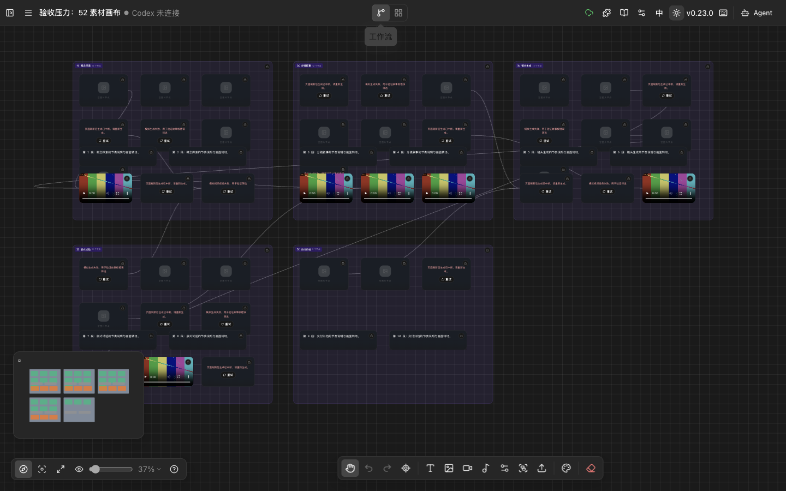
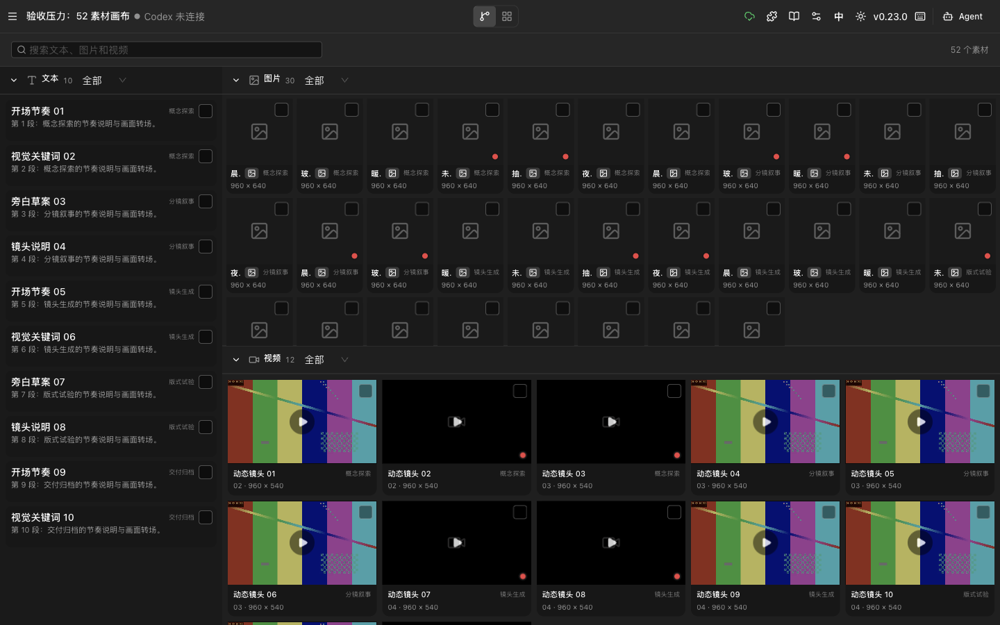
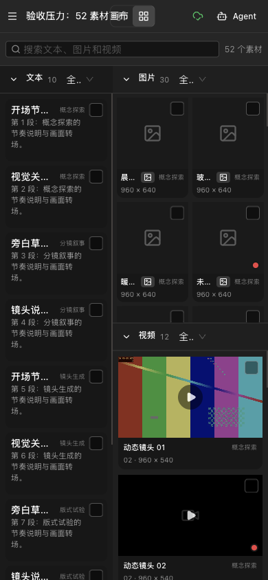
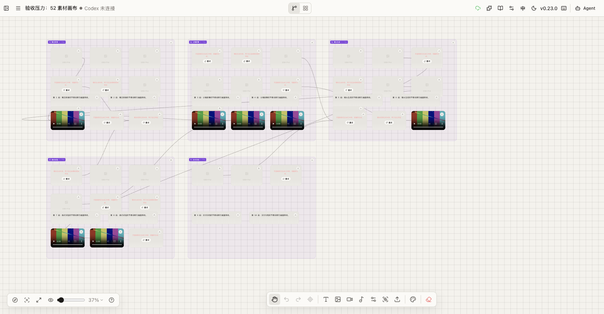

# 项目自有化与高密度画布验收

**验收日期：** 2026-11-03

**环境：** Infinite Canvas 本地预发版本 `http://127.0.0.1:4173/`，Ego Browser，TaskSpace `infinite-canvas-ownership-stress-20261103`（53）。

**结论：** 高密度工作流和故事板在 1440×900、390×844、深色和浅色主题下未出现横向溢出、模块错位或关键交互阻断。品牌与文档入口已切换到当前仓库，Docker 默认从源码构建。实现已通过提交 `1d6ec9f` 推送到 PR [#20](https://github.com/Smithhss/infinite-canvas/pull/20)，Quality CI run `41585499344` 通过；尚未合并或部署。

## 测试数据

| 项目 | 数量 |
| --- | ---: |
| 分组节点 | 5 |
| 图片节点 | 30 |
| 视频节点 | 12 |
| 文本节点 | 10 |
| 素材总数 | 52 |
| 节点总数 | 57 |
| 连线 | 10 |

测试项目使用独立 ID `stress52_20261103_ownership`，覆盖成功、生成中、失败三种状态。验收结束后已从 IndexedDB 删除，不修改现有画布。

## 浏览器结果

| 检查项 | 结果 | 实测 |
| --- | --- | --- |
| 1440×900 工作流 | 通过 | 57 个节点，`scrollWidth = innerWidth = 1440` |
| 1440×900 故事板 | 通过 | 显示 52 个素材，文字 10、图片 30、视频 12 |
| 390×844 故事板 | 通过 | `scrollWidth = innerWidth = 390`，无页面横向或纵向溢出 |
| 双栏独立滚动 | 通过 | 左栏 164px；右栏 226px；图片和视频模块分别滚动 |
| 搜索 | 通过 | 搜索“动态镜头 10”后仅剩 1 个素材，清空后恢复 52 个 |
| 状态筛选 | 通过 | 图片模块可切到“生成中”和“失败”，素材数和可见卡片同步变化 |
| 模块折叠 | 通过 | 文本模块收起后内容从 DOM 消失，展开后恢复 |
| 多选返回画布 | 通过 | 选择 2 个素材后点击“在画布中处理”，返回工作流并保留 2 个节点选中态 |
| 连线 | 通过 | 默认 2px / `.72`；hover 2.5px / `.92`；选中 3px / `1` |
| 节点工具条 | 通过 | 高 44px、圆角 12px，深色和浅色主题均使用主题 token |
| 小地图 | 通过 | 240×160，圆角 12px，阴影 `0 8px 24px rgba(0,0,0,.16)` |
| 右键菜单 | 通过 | 圆角 12px；深色 hover 为白色 10%，浅色使用主题面板 |
| 分组标题 | 通过 | 5 个分组标题的计算圆角均为 6px |
| 浅色主题 | 通过 | 工具条 `rgba(251,250,247,.96)`，文字 `rgb(41,37,36)` |

## 项目自有化结果

| 项目 | 状态 |
| --- | --- |
| README 品牌与安装入口 | 已改为 `Smithhss/infinite-canvas` |
| 文档导航、仓库链接与版本检查 | 已改到当前仓库 |
| Codex 插件作者、主页和仓库 | 已改为 `Smithhss` |
| Docker Compose | 已改为从当前源码构建 |
| GitHub Actions 镜像名 | 已显式使用小写 `ghcr.io/smithhss/infinite-canvas` 和 `ghcr.io/smithhss/infinite-canvas-docs` |
| 上游宣传图、社区群和 Star History | 已从自有入口移除 |
| MIT 原始版权声明 | 保留 |

未迁移项：

- `@basketikun/canvas-agent`
- `@basketikun/canvas-proxy`
- 官方插件 registry
- 浏览器存储命名空间 `infinite-canvas`

这些名称仍承担安装、更新或本地数据兼容职责，不能在缺少替代发布和迁移设计时直接改名。

## 清理结果

静态引用扫描后删除了以下孤儿文件：

- `web/src/components/canvas/canvas-size-picker.tsx`
- `web/src/components/image-generation-pending.tsx`
- `web/src/components/layout/github-link.tsx`
- `web/src/components/ui/dia-text-reveal.tsx`
- `web/src/stores/use-user-store.ts`
- `docker-compose.local.yml`
- `docs/docker-compose.local.yml`
- `docs/public/qq.svg`

同时删除了 `canvas-image-data.ts`、内置 Agent 附件/上下文、API 参数序列化、WebDAV 文件传输和配置 store 中未被引用的导出。

## 截图

| 页面 | 截图 |
| --- | --- |
| 深色工作流，1440×900 |  |
| 深色故事板，1440×900 |  |
| 深色故事板，390×844 |  |
| 浅色工作流，1440×900 |  |

## 剩余风险

- 尚未在真实手机和真实桌面浏览器上验收触控、设备像素比、系统字体和长会话滚动。
- 100 个以上素材时的 DOM 数量、图片解码和选择性能尚未压测；当前没有证据支持立即引入虚拟列表。
- GitHub Actions 的 Docker 镜像与插件发布工作流只在版本 tag 或手动触发时运行，尚未随 PR 发布远端制品。
- npm 包、插件 registry 和存储命名空间仍依赖兼容名称。
- 改动已提交、推送并创建 PR；尚未合并或部署生产。
