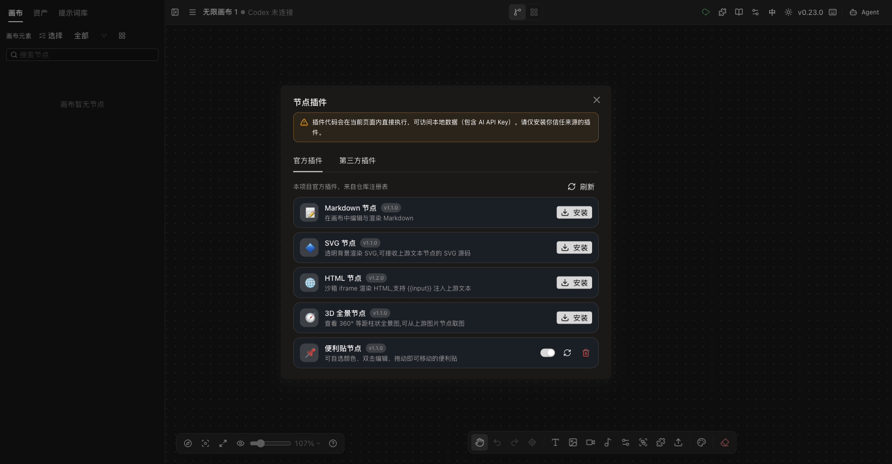
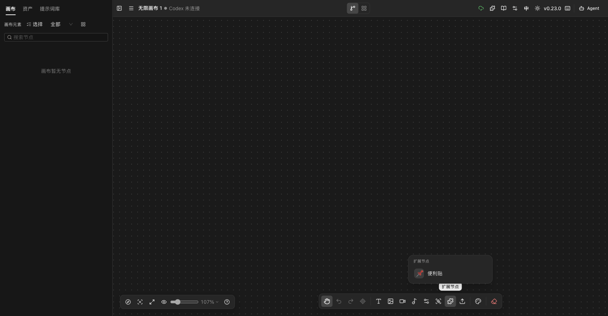
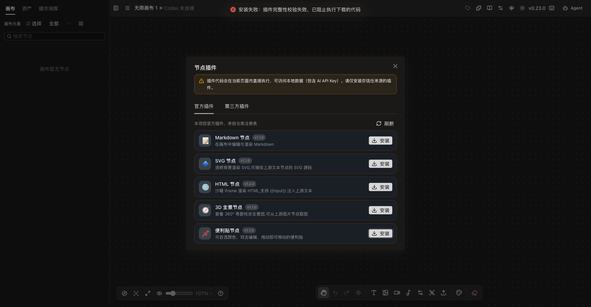

# 自有插件 Registry 验收

**验收日期：** 2026-11-03

**环境：** Infinite Canvas `v0.23.0`，独立本地预发 `http://127.0.0.1:4174/`，Ego Browser TaskSpace `infinite-canvas-plugin-registry-20261103`（54）。

**结论：** B1 自有插件 registry 的构建、清单、完整性校验、安装、更新、禁用、重新启用、卸载和失败关闭链路已在本地通过。官方默认地址已切到 `Smithhss/infinite-canvas`，但远端 `plugins-dist` 分支尚未实际发布，不能把本轮视为线上发布完成。

## 清单与制品

清单已升级为 `schemaVersion: 1`，每条包含 `sha256`、`size`、`minAppVersion` 和 `platform`。构建与发布前校验共同使用 `official-plugins.mjs` 登记表。

| 插件 | 版本 | 大小 | 结果 |
| --- | --- | ---: | --- |
| markdown | 1.1.0 | 3691 B | 通过 |
| svg | 1.1.0 | 3102 B | 通过 |
| html | 1.2.0 | 3448 B | 通过 |
| panorama | 1.1.0 | 7040 B | 通过 |
| sticky-note | 1.1.0 | 4141 B | 通过 |

`npm run validate` 会重新读取每个 bundle，核对入口路径、大小、SHA-256、平台、最低应用版本和完整的 5 项插件集合。CI 在 force-push `plugins-dist` 之前执行同一校验。

## 浏览器结果

| 检查项 | 结果 | 实测 |
| --- | --- | --- |
| 官方清单加载 | 通过 | 面板显示 Markdown、SVG、HTML、3D 全景和便利贴 5 项 |
| 官方安装 | 通过 | 便利贴安装后出现“扩展节点”入口和“便利贴”节点项 |
| 更新 | 通过 | 从来源更新成功，插件保持启用 |
| 禁用 | 通过 | 关闭开关后扩展入口消失 |
| 重新启用 | 通过 | 开启后扩展入口和便利贴项恢复 |
| 卸载 | 通过 | 卸载后恢复为“安装”按钮 |
| 刷新持久化 | 通过 | 页面刷新后启用状态和扩展入口仍存在 |
| 篡改 SHA-256 | 通过 | 安装前拒绝执行，显示完整性失败，未产生安装记录 |
| 未知 schemaVersion | 通过 | 整个清单被拒绝，不显示任何安装按钮 |
| 重复插件 ID | 通过 | 整个清单被拒绝，不显示任何安装按钮 |
| registry 缺失 | 通过 | 显示 HTTP 404 失败，不回落旧清单或部分条目 |

## 截图

| 页面 | 截图 |
| --- | --- |
| 5 个官方插件及已安装便利贴 |  |
| 安装后的扩展节点入口 |  |
| SHA-256 不匹配时失败关闭 |  |

## 安全与兼容边界

- 官方安装必须提供哈希和大小；官方来源缺少完整性信息时直接失败，不把未知来源标记为官方。
- 插件 bundle 下载后先核对大小和 SHA-256，再动态执行；校验失败不会触发插件代码。
- 官方 bundle 自报的 ID 和版本必须与清单一致，插件声明的 `minAppVersion` 也会在激活前检查。
- 已安装的官方记录保存哈希和大小；启动和重新启用时使用缓存源码也会先校验。
- 第三方 URL 安装仍允许无哈希，继续属于用户明确承担风险的非官方路径。
- 旧安装记录没有 `sha256` / `size` 时仍可加载，避免本次升级丢失现有插件；重新从官方来源安装或更新后会补齐完整性字段。

## 自动化验证

| 命令 | 结果 |
| --- | --- |
| `bun test tests/plugin-registry.test.ts` | 8 pass，0 fail，40 assertions |
| `bun run typecheck` | 通过 |
| `npm run build && npm run validate` | 通过，5 个插件 |
| Web 全量测试 | 115 pass，0 fail，386 assertions |
| Web 类型检查与生产构建 | 通过 |
| Docs 类型检查与构建 | 通过 |

## 剩余风险

- `origin/plugins-dist` 当前不存在；只有打 `v*` tag 或手动运行发布工作流后，默认 jsDelivr 地址才会有制品。
- 本轮没有提交、推送、触发远端工作流、打 tag 或部署生产。
- 默认 jsDelivr 地址和真实 GitHub Actions 发布链路尚未在线验证。
- 第三方插件仍会直接在页面内执行，现有风险提示和用户信任边界没有改变。
